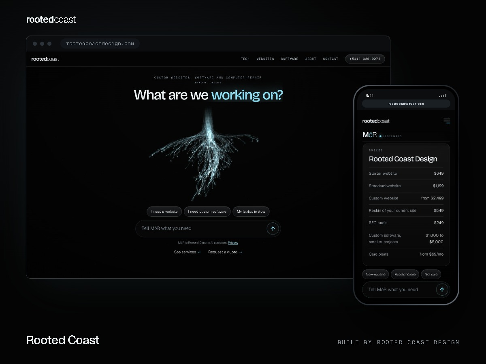
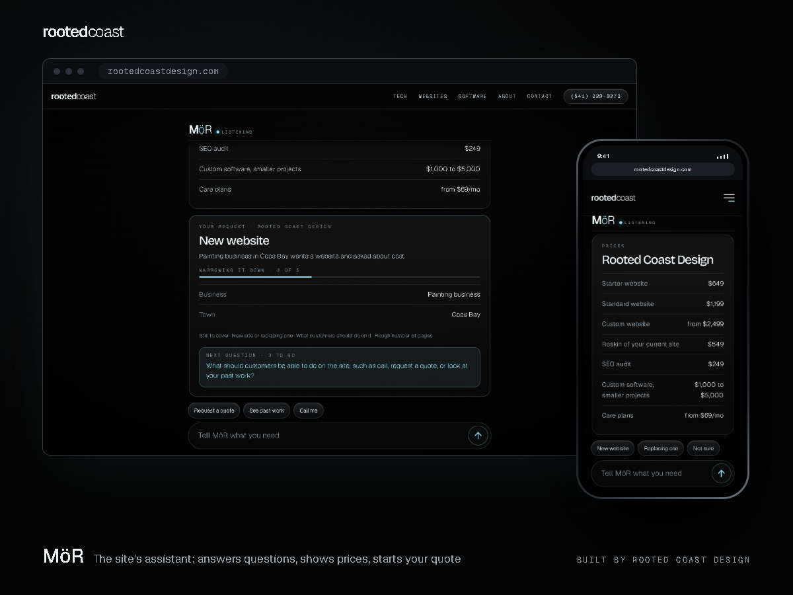

# rootedcoastdesign.com

The website for [Rooted Coast Design](https://www.rootedcoastdesign.com), a web design, software and computer repair studio in Bandon, Oregon. Designed, written and built by hand.

**Live site:** https://www.rootedcoastdesign.com



## Overview

The site has 49 pages, an AI assistant called MöR, a guided quote form and Stripe checkout. There is no framework, page builder or CMS. Every page is static HTML, CSS and vanilla JavaScript, and the server side is a small set of Node.js serverless functions on Vercel.

This repository holds the site as it is deployed: the finished pages, the serverless functions and their tests. The pages are generated by a private build step that assembles each one from shared parts and inlines its styles and scripts, so every page loads as a single file.

The home page opens with one question, "What are we working on?", and a place to answer it. A visitor can type what they need, tap a suggestion such as "My laptop is slow", or skip straight to the services and the quote form.

## What's on the site

| Pages | What they do |
|---|---|
| Home | The assistant, a summary of each service, recent work and reviews |
| Websites, Software, Tech | One page per service, with its prices and details |
| About, Contact | The owner's story and how to get in touch |
| Request | A guided request form for any service |
| Starter, Standard, Custom, Custom software | A product page for each website package and for smaller software projects, with a picture gallery and the order or quote button |
| Quote | The photo estimate page used by client websites |
| Service areas, plus 29 town pages | Local pages for towns on the Oregon and Washington coast and the Eugene area |
| Privacy, Terms, 404 | The legal pages and a custom error page |
| Cart, Success, Cancel | Stripe checkout and its return pages |

## How it works

### MöR, the site assistant



- **Plain-language help.** Visitors describe what they need in their own words. MöR answers from the site's own content and prices, and asks a few short questions to understand the job.
- **Cards instead of walls of text.** Prices, past projects and the visitor's request appear as cards in the conversation. The request card fills in as the conversation goes, shows how many questions are left, and ends as a request the owner can act on.
- **Streamed replies.** Answers appear as they are written, over a streamed response from a serverless function.
- **Private instructions.** MöR's instructions live only on the server. Each page sends the id of its approved set, and the server refuses anything else, so the page cannot be edited to change how he behaves.
- **Private by design.** The API key stays on the server, requests are rate limited per visitor, and conversations are deleted after 90 days, as the privacy page says.

### Guided quote form

- **One list of questions.** The questions live in one file. The form is drawn from that list and the server checks every answer against the same list, so the two can never disagree.
- **Branching by service.** A website request, a software project and a computer repair each get their own short set of questions, a few at a time, with a "not sure" answer wherever one makes sense.
- **Two emails.** The owner gets the request in the site's own design, with a signed private link to the full details. The visitor gets a confirmation with a copy of their answers.
- **Spam protection without a puzzle.** A hidden field, a minimum time on the form and a per-visitor limit stop bots without asking people to prove they are human.
- **Nothing lost.** Every request is saved before the email is sent, so a failed email never loses a request.

### Photo quote widget

An estimate form that drops into client websites with one script tag. Customers describe the job and attach photos, and the business gets the request by email. Each client's trade, questions, colors and notification settings come from one configuration file, and the widget is covered by end-to-end and theme tests.

### Checkout

Stripe Checkout handles payments. Prices are looked up on the server from `pricing.js`, never taken from the browser, so the amount charged cannot be changed on the page.

### One source of truth for prices

Every price on the site comes from `pricing.js`. `check-prices.js` reads every page and fails if any price disagrees with it, so a price change is made in one place.

### A 404 page that draws itself

Lines of code fall down the screen, and the characters that land inside the shape of "404" stay lit. With reduced motion turned on, the number is simply shown.

## Speed, search and sharing

- **Fast on phones.** Images are sized and served as WebP, each page's styles are inlined, fonts are preloaded, and analytics load only after the first interaction or a few seconds after the page. The Lighthouse phone performance score went from 80 to 96 after this work.
- **Search.** Lighthouse SEO scores 100 on the pages tested. Service and town pages carry structured data for Google.
- **Sharing.** Every page has its own title, description, share image and share line, so a link posted on Facebook or in a text says which page it is.

## Stack

| Layer | Used here |
|---|---|
| Pages | Static HTML, CSS, vanilla JavaScript |
| Hosting and functions | Vercel (Node.js serverless functions in `api/`) |
| Assistant | Anthropic API, streamed |
| Payments | Stripe Checkout |
| Email | Resend |
| Storage | Neon Postgres and Vercel Blob |
| Tests | Node.js scripts in `test/`, plus the price check |

## Structure

```
*.html          The pages, as deployed
api/            Serverless functions: quote form, checkout, photo quotes
lib/            Shared server code used by the functions
test/           End-to-end and unit tests for the photo quote widget
pq-widget.js    The embeddable photo quote widget
pricing.js      Every price, in one place
check-prices.js Checks each page against pricing.js
dev-server.js   Serves the site and runs the functions locally
art/, img/, towns/, portfolio/, products/   Images
og/, icons/     Share images and icons
vercel.json     Redirects, headers and function settings
```

## Running it locally

```bash
npm install
npm test
npm run dev
```

MöR's server function and his instructions are private and are not part of this repository; the chat window in each page is included, since every visitor's browser receives it.

`npm test` checks every price and runs the photo quote tests. `npm run dev` serves the site at http://localhost:3000 with the functions running. The functions expect their keys as environment variables (`STRIPE_SECRET_KEY`, `RESEND_API_KEY` and the storage settings). None are included in this repository.

## About this copy

This is a public reference copy of a production site. Client notification addresses have been replaced with placeholders, and internal working notes are not included.

## License

Copyright © Rooted Coast Design LLC. All rights reserved. The code is published for reference and is not licensed for reuse.
